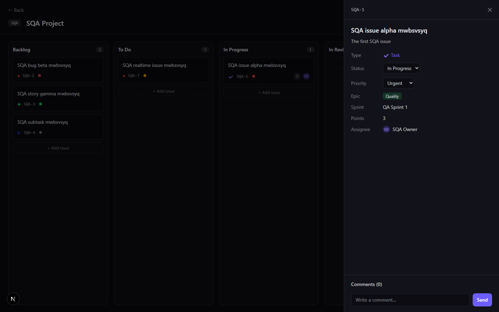
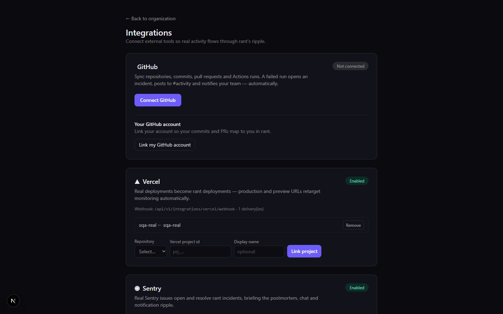

# SQA Report — rant

**Date:** 2026-11-11
**Target:** local stack — API `http://127.0.0.1:4000`, web `http://127.0.0.1:3000`,
Postgres 16 + Redis 7 (Docker), database `rant_dev`.
**Build:** working tree (all changes in this pass uncommitted), Node 22, pnpm 11.
**Verdict:** the core product loop works end to end. **92/92 API checks and 9/9
browser checks pass** after fixing the defects below.

---

## 1. Method

SQA was performed by **creating real data through the public API** — not by
mocking — and then observing the side effects through the API, the database and
a real browser:

- **API suite** (`apps/api/scripts/sqa.mjs`): registers users, builds an
  organization from scratch, exercises every module (CRUD + negative cases),
  triggers the CI → deploy → monitor → incident → bug → postmortem → notification
  → chat → webhook ripple, verifies HMAC signatures, and checks tenancy/RBAC.
- **Browser suite** (`apps/api/scripts/ui-sqa.mjs`): drives headless Edge over
  the Chrome DevTools Protocol, logs in through the real form, opens the board
  and integrations pages, asserts rendered content and captures screenshots.
- **Regression suites**: 94 unit tests + 17 e2e tests (real Postgres/Redis).

The SQA data is intentionally left in place so it can be inspected in the UI:
open **SQA Corp (QA)** on the dashboard. The suite is idempotent per run (new
org/users each time); it never touches the seeded `Acme` demo.

## 2. Results

| Suite | Result |
|---|---|
| API SQA (`pnpm sqa`) | **92 / 92 passed** |
| Browser SQA (`pnpm sqa:ui`) | **9 / 9 passed** |
| Unit tests (`pnpm test`) | **94 / 94 passed** (21 suites) |
| E2E tests (`pnpm test:e2e`) | **17 / 17 passed** (2 suites) |
| Typecheck / build | clean |

### API coverage by area

| Area | Checks | What was verified |
|---|---|---|
| Health | 2 | liveness; readiness (Postgres + Redis) |
| Auth | 8 | register, duplicate, bad password, login, me, refresh rotation + replay rejection, unauthenticated rejection, logout/revocation |
| Planning | 11 | org/workspace/project CRUD, duplicate keys, sprint + epic, issue numbering, filters, update, comments, subtasks |
| RBAC | 8 | email invite + preview + accept, devops invite, OWNER-invite rejection, seat limit, developer 403, non-member 404 |
| Billing | 5 | FREE limits (3rd repo, 3rd project), usage, PRO upgrade + invoice, cancel/resume |
| Repositories | 4 | default branch/env, duplicate slug, branch + commit head advance, tag + release |
| Webhooks | 1 | endpoint creation + secret |
| CI/CD | 5 | pipeline create/run, step logs, SSE stream, auto-deploy, deployment logs, staging deploy/rollback/cancel |
| Monitoring | 8 | monitor target, metrics, outage → CRITICAL incident + bug, postmortem doc, notifications/chat/webhook fan-out, recovery, delivery ledger |
| Pull requests | 3 | failing CI blocks merge (409), green PR merge + merge SHA, merge queue enqueue/list/process |
| Integrations | 5 | Vercel link + signed deployment → READY + URL normalization, bad signature, dedupe, Sentry link + CRITICAL issue + resolve |
| Realtime | 1 | authenticated Socket.IO org room receives `incident.opened` with correct payload |
| Knowledge | 5 | doc versioning + restore, unified search, saved searches, copilot answer + citations, file upload/download/delete |
| Platform | 5 | API key auth + revoke, analytics aggregates, audit actions, chat channel, notification read/preferences |
| UI | 21 | every page route renders (200) |

### Browser coverage

Login form → dashboard redirect, dashboard org rendering, board issue rendering +
issue drawer, integrations cards (GitHub/Vercel/Sentry + link form), repository
page project-link options, chat channels, notification feed, and zero uncaught
browser exceptions.




## 3. Defects found and fixed

| # | Severity | Finding | Evidence | Fix |
|---|---|---|---|---|
| 1 | High (onboarding) | The seeded demo owner could not log in: the seed stored a placeholder hash instead of an argon2 hash. | `POST /auth/login` with `founder@rant.dev` returned 401. | Seed now hashes the demo password with argon2 and repairs an existing hash on re-seed (`packages/database/prisma/seed.ts`). |
| 2 | Medium (functional) | Sprints could not be created with a status — `status` was rejected as an unknown property, forcing a second PATCH to start a sprint. | `POST .../sprints` with `status: "ACTIVE"` → 400 `property status should not exist`. | `CreateSprintDto` accepts and persists `status` (`sprints/dto/sprint.dto.ts`, `sprints.service.ts`). |
| 3 | Low (API consistency) | Mutation endpoints returned `201 Created` even when nothing was created (`POST /notifications/:id/read` etc.). | Mark-read returned 201. | Action endpoints now return 200: notification read/read-all, run/deployment cancel, incident acknowledge/resolve, monitor simulate, PR merge, merge-queue process, billing cancel/resume. |
| 4 | High (test reliability) | E2E and a running dev API shared the same Redis BullMQ queues, so the dev worker consumed e2e jobs and silently dropped them (it looked up links in the wrong database). | 5 e2e failures only when the dev stack was running; all passed when it was stopped. | `REDIS_URL` now honors the `/N` database index, and the e2e harness uses database 1 (`app.module.ts`, `test/utils.ts`). |
| 5 | Low (UX) | The repo creation form could not link a repository to a project, hiding the incident → bug → postmortem ripple from UI-created repos. | Repo form only sent name/slug. | Added an optional project selector to the repositories page; browser SQA now asserts it renders the project options. |

## 4. Observations / known gaps (not SQA failures)

- **Simulated workers.** CI, deploys and health probes are deterministic
  simulations; GitHub/Vercel/Sentry are the only real external inputs. The SQA
  validates the execution model, not real code execution.
- **Prober randomness.** The health simulator has a 3% transient-failure chance,
  so an unrelated "Staging is down" incident can appear during a long demo. It is
  by design, but noisy for scripted demos.
- **API-only surfaces.** Branches, PRs, reviews, tags, releases and the merge
  queue work but have no dedicated screens (Swagger only). The board, repos,
  pipelines, deployments, monitoring, chat, docs, analytics, billing, API,
  audit, members and integrations are the complete UI surface.
- **Search/AI depth.** Search is SQL `contains`; Copilot is deterministic intent
  classification over live data (no external LLM).
- **Production readiness** (SSO/SCIM, compliance, multi-region, real billing,
  email provider) is out of scope for this SQA and unchanged.

## 5. Reproduce

```bash
# with the stack running (docker compose up -d; pnpm dev)
pnpm sqa       # API SQA — creates "SQA Corp (QA)" with data
pnpm sqa:ui    # headless-browser SQA + screenshots (ui-board.png, ui-integrations.png)
pnpm test      # 94 unit tests
pnpm test:e2e  # 17 e2e tests (uses Redis DB 1 and the e2e database)
```
